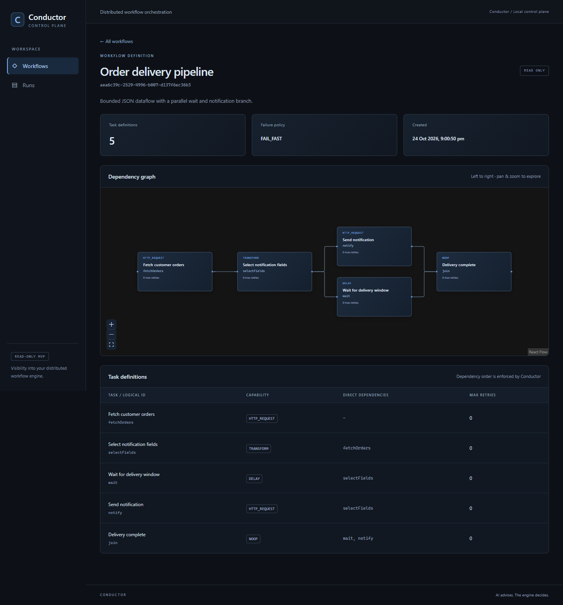
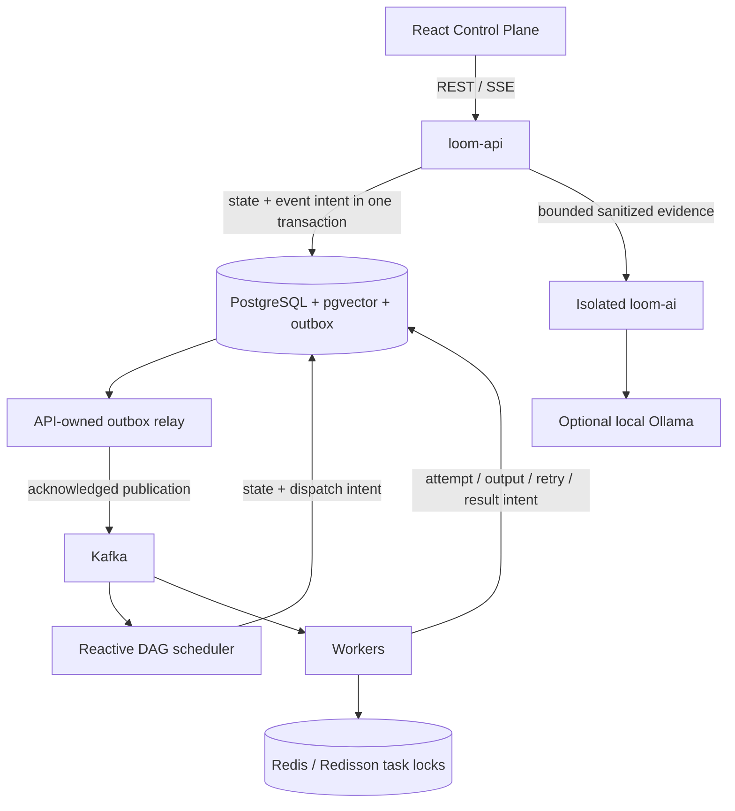
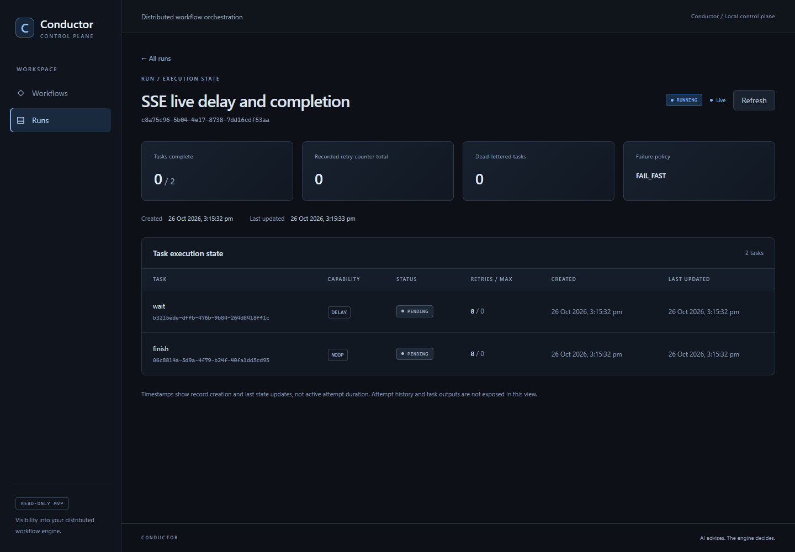
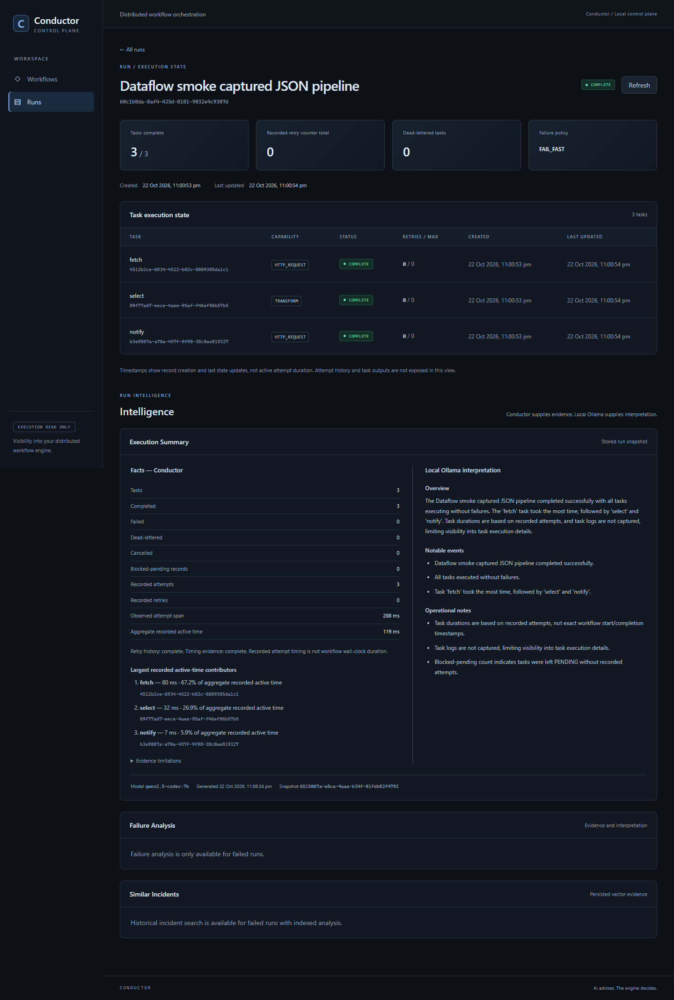
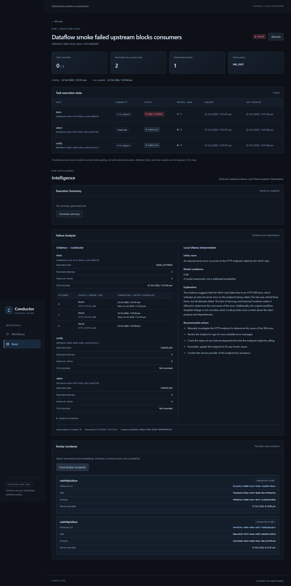
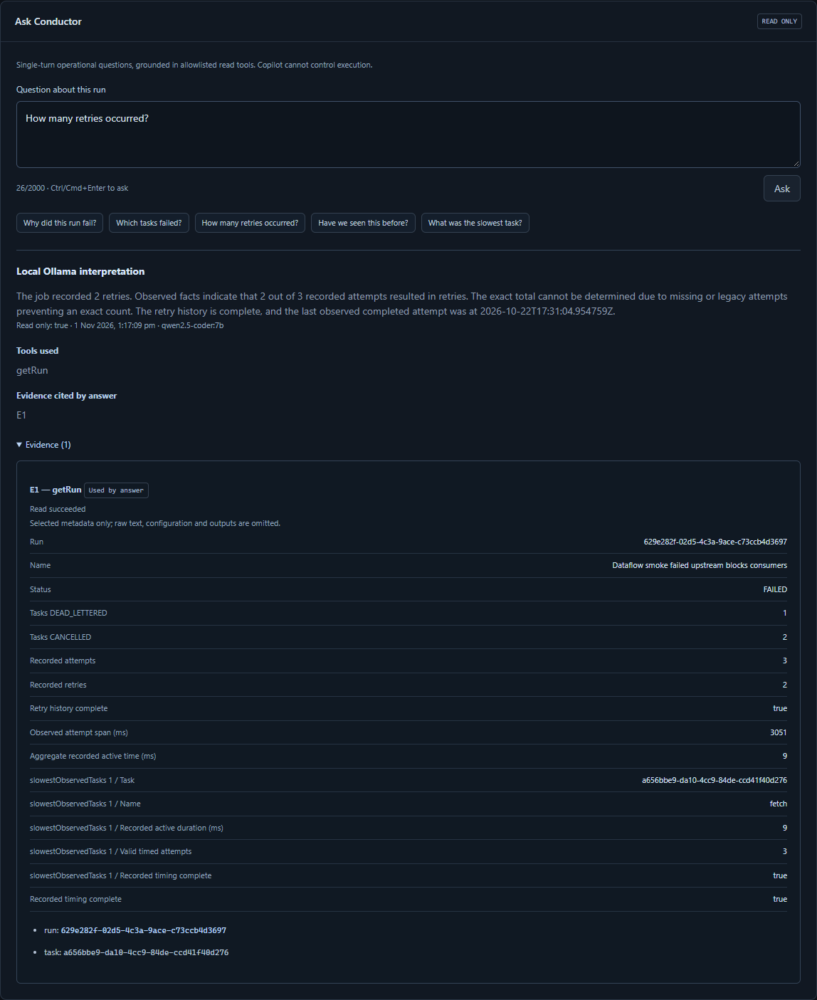
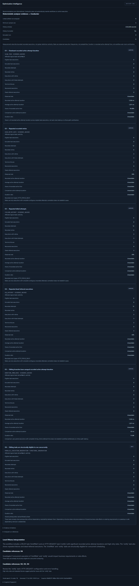
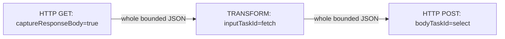
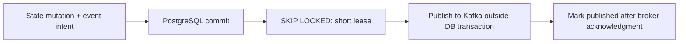

# Conductor

[](https://github.com/tarunkishore2303/conductor/actions/workflows/ci.yml)
[](LICENSE)

**A distributed workflow orchestration platform with durable execution, failure intelligence and evidence-backed local AI.**

[](https://github.com/tarunkishore2303/conductor/releases/tag/v1.0.0)

[Watch the technical demo](https://github.com/tarunkishore2303/conductor/releases/download/v1.0.0/Conductor-v1.0.0-technical-1080p.mp4) | [Short product tour](https://github.com/tarunkishore2303/conductor/releases/download/v1.0.0/Conductor-v1.0.0-linkedin-1080p.mp4) | [v1.0.0 release](https://github.com/tarunkishore2303/conductor/releases/tag/v1.0.0)

## Why Conductor

A workflow engine becomes interesting when a worker crashes, retries must survive
restarts, or a database commit succeeds while Kafka is unavailable. Conductor
makes those boundaries explicit, then adds intelligence that can explain the
recorded evidence without controlling execution.

The platform evolved from [Project Loom](https://github.com/tarunkishore2303/project-loom)
and preserves its original Git history and `loom-*` module names.

- **Deterministic orchestration:** validated DAGs, typed task handlers and explicit failure policies.
- **Durable distributed execution:** PostgreSQL state and event intent, leased outbox delivery, Kafka and Redis coordination.
- **Evidence-backed intelligence:** deterministic facts first; optional local Ollama interpretation second.

This is a local-first portfolio and study platform, not an authenticated SaaS,
a Temporal replacement or an autonomous agent system.

## Architecture



| Module | Responsibility |
|---|---|
| `loom-common` | Execution models, event contracts, deterministic identity and shared outbox writer |
| `loom-api` | Workflow/run APIs, validation, persistence, intelligence snapshots, SSE and outbox relay |
| `loom-scheduler` | R2DBC DAG readiness and transactional dispatch intent |
| `loom-worker` | Typed capability execution, locks, attempt persistence, retries and DLQ |
| `loom-monitor` | Read-only execution statistics |
| `loom-ai` | Local model adapters, structured responses and dedicated output validation |
| `loom-observability` | Shared low-cardinality operation instrumentation |
| `loom-task-capabilities` | Typed configuration, capability catalog and safety validation |
| `conductor-ui` | React/TypeScript Control Plane |

## How execution works

1. Create a workflow template, then submit a separate run through REST.
2. Conductor validates capability configuration, direct dataflow references and DAG invariants.
3. The API commits the job, tasks, dependencies and `job-created` outbox intent together.
4. The relay publishes committed intent; the scheduler transaction records ready-task dispatches.
5. A worker acquires its Redisson task lock, resolves declared inputs and executes the registered handler.
6. Attempt results, bounded successful output and the next event intent commit together.
7. The scheduler releases eligible dependants or applies the failure policy.

`FAIL_FAST` cancels pending tasks after terminal failure. `CONTINUE_ON_FAILURE`
permits independent work to continue; the job may already be marked FAILED while
that work is active. A cancellation request prevents future worker starts but
does not interrupt a running handler; see the cancellation limitation below.

## Control Plane

Open **http://localhost:3001** after Compose starts.

| Screen | What it exposes |
|---|---|
| Workflows | Templates, metadata and read-only DAG visualization |
| Runs | Recent runs, task states, capability types and retry counters |
| Run intelligence | Execution summaries, failure evidence and similar historical incidents |
| Ask Conductor | A single-turn, read-only question with inspectable tool evidence |
| Workflow optimization | Stored advisory candidates and separate model interpretation |

REST is authoritative. Active run detail uses SSE invalidation notifications to
refetch the REST snapshot; reconnects recover through REST, with five-second
polling fallback when streaming is unavailable. Terminal state closes the stream.
SSE has no durable replay and is process-local. Task state can remain PENDING
while a handler runs because its transaction commits at attempt completion.

The UI does not create/edit/execute workflows or expose captured outputs. Its four
POST exceptions compute intelligence only: Copilot, summary, failure analysis
and optimization. Workflow/job mutations, approval, replay, indexing, synthesis,
PUT, PATCH and DELETE remain blocked through UI nginx. Use the REST collection
for manual workflow creation, approval and execution.

<details>
<summary>Real execution and intelligence screenshots</summary>






These are real local captures. The Copilot image includes an unsupported legacy-history
caveat despite complete retry evidence: model prose can be wrong even when counts
are correct. The cited facts are separately inspectable. Similarity scores and
model confidence are not probabilities.



</details>

## Task capabilities and dataflow

| Type | Purpose | Important boundaries |
|---|---|---|
| `NOOP` | Orchestration and compatibility demos | Simulated 50 ms work |
| `DELAY` | A bounded wait | 0-30,000 ms |
| `HTTP_REQUEST` | HTTP GET/POST | Default request 16 KiB, response 64 KiB; timeout at most 10 s; redirects disabled |
| `TRANSFORM` | Deterministic JSON_SELECT / JSON_RENAME | Static JSON or one whole direct-dependency output; no scripts or expressions |

Handlers are registered through Spring IoC. They execute one capability and return
its result; workers own persistence, locking, retries, DLQ and publication intent.



Output belongs to a successful `TaskExecution`, not mutable task state. HTTP capture
is **opt-in** and supports bounded UTF-8 JSON/plain text. Persisted output has a
64 KiB hard ceiling; failed attempts expose no successful output. Inputs may name
one declared **direct dependency in the same run**. Static transforms and static
POST bodies remain supported.

Conductor does not implement a general variable/expression language, JSONPath,
interpolation, dynamic fan-out, shell, JavaScript, Python or SQL execution.
Captured outputs are persisted in the database and must not contain secrets.
They are excluded from Kafka/outbox payloads, normal UI views and AI intelligence.

## Durable execution and transactional outbox

PostgreSQL is authoritative for execution state **and exact serialized event intent**.
Those writes share one transaction in API, worker and reactive scheduler paths.
The existing topics remain `job-created`, `task-queue` and `task-results`.



A relay claims one due row at a time, up to a bounded batch, using expiring leases
and per-claim fencing tokens. Failed publication keeps the row and retries with
bounded backoff. A crash after Kafka ACK but before `published_at` can publish the
same event again: this is expected **at-least-once delivery**. Deterministic dedupe
keys, task locks, recorded attempt identity and consumer state checks tolerate it.
Published rows are retained for diagnosis.

```text
failed attempt
  -> TaskExecution FAILED + retryScheduledAt
  -> Task PENDING + future task-queue outbox row
  -> COMMIT
  -> available_at reached
  -> relay -> Kafka -> next worker attempt
```

Retry delays retain 1, 2, 4... seconds. Initial `available_at` equals the persisted
`retryScheduledAt`; scheduling is durable in PostgreSQL rather than worker memory.
Default relay settings (`conductor.outbox.*`) are poll 500 ms, batch 50, lease 30 s
and publish timeout 10 s. Leases must exceed twice the publish timeout. Payloads
are limited to 32 KiB and never include task output/configuration.

Initial execution uses generation 0, attempts 0, 1, ...; manual DLQ replay increments
the generation and starts at attempt 0 again. Generation zero preserves historical
UUIDs derived from `taskId-attempt`; later identities use `taskId:generation:attempt`.
Queue dedupe includes task/generation/attempt; result dedupe includes execution ID
and status. Replay creates fresh attempts without sacrificing duplicate-delivery
idempotency. Old evidence remains stored; current intelligence explicitly excludes
prior replay generations. Replay resumes only the selected task, not cancelled descendants.

This is not distributed exactly once. An external HTTP side effect followed by a
crash before completion commit can repeat after redelivery. Exactly-once external
effects require downstream cooperation/idempotency keys, outside v1.0.

V1-V12 migrations are owned by `loom-api`. Never edit a merged migration. Upgrade
API, scheduler and workers together; legacy Kafka records default to generation zero.
V12 does not invent publication intent for historical pre-outbox gaps.

## Failure intelligence and incident memory

Java collects bounded attempt, retry, timing, error-type and DLQ facts. Ollama may
interpret them; immutable snapshots persist and are reused by stable context hash.
Summaries require settled COMPLETE/FAILED runs; failure analysis requires settled
failure evidence. GET reads stored results without generating anything.

Incident memory uses local `nomic-embed-text:v1.5` embeddings and PostgreSQL
`vector(768)`. Retrieval returns real historical run/analysis references and cosine
similarity scores, not probability or proof of a common cause. The current run must
already have analyzed/indexed evidence. Already-indexed retrieval needs no model call.
Optional synthesis stays evidence-backed; it is not a separate UI feature.

## Copilot and optimization

**Copilot is read-only and single-turn:** question -> bounded allowlisted read tools
-> structured evidence -> local interpretation with citations. It cannot retry,
cancel, schedule, mutate workflows, call workers or execute SQL. Deterministic
read-only notices are distinguished from `OLLAMA_INTERPRETATION` answers.

**Optimization is advisory:** workflow structure + bounded explicitly linked history
-> deterministic Java analyzers -> candidates -> optional Ollama explanation.
Candidates cover slow tasks, retries, failures, DLQ, duration imbalance and structural
parallel-execution observations. The latter do not establish business independence.
Recorded active attempt time is not workflow wall-clock or critical-path contribution.
Insufficient history/no candidates uses a deterministic path without inference.
There is no Apply endpoint or automatic workflow rewrite.

## AI workflow generation and trust model

```text
description -> structured proposal -> capability + dataflow + DAG validation
            -> persisted preview -> explicit approval -> separate execution
```

Manual creation and AI approval share normal WorkflowService validation/persistence.
Generation and approval never execute a job. Every model response is untrusted and
passes dedicated validators; Java calculates authoritative counts, rates and timing.

- PostgreSQL is truth; Kafka transports events at least once; consumers tolerate duplicates.
- AI interprets bounded sanitized evidence and has no execution authority.
- Task outputs stay outside intelligence surfaces.
- Copilot is read-only; optimization is advisory.
- Ollama is optional. Execution, stored intelligence and indexed retrieval remain
  usable during an outage; fresh model-dependent generation returns safely unavailable.

Supported local models are `qwen2.5-coder:7b` and `nomic-embed-text:v1.5`. No cloud
fallback, cloud provider or AI API key is required. Compose sets `OLLAMA_NO_CLOUD=true`.

## Local quick start

Requirements: Docker with Compose, or Podman with standalone Docker Compose.
Java 25 and Python 3.13 are needed for host-side build/tests; Node 24 for UI development.
The container build uses the checked-in Gradle wrapper.

```bash
git clone https://github.com/tarunkishore2303/conductor.git
cd conductor
docker compose up --build -d
```

Windows/Podman equivalent:

```powershell
podman machine start
.\scripts\compose.ps1 up --build -d
```

| Surface | URL |
|---|---|
| Control Plane | http://localhost:3001 |
| API / Swagger | http://localhost:8080/swagger-ui.html |
| API health | http://localhost:8080/actuator/health |
| Monitor statistics | http://localhost:8083/monitor/stats |
| Prometheus | http://localhost:9090 |
| Grafana | http://localhost:3000 (local defaults `admin` / `admin`) |

The UI binds loopback; several other Compose development ports bind host interfaces.
This is **not a safely public deployment**. Do not expose the stack to the internet:
there is no authentication, tenant isolation or production secret management.
Development database credentials are local defaults, not deployment secrets.

For optional AI, explicitly install the existing models:

```bash
AI_ENABLED=true docker compose --profile ai up --build -d
docker compose --profile ai exec ollama ollama pull qwen2.5-coder:7b
docker compose --profile ai exec ollama ollama pull nomic-embed-text:v1.5
```

```powershell
$env:AI_ENABLED='true'
.\scripts\compose.ps1 --profile ai up --build -d
.\scripts\compose.ps1 --profile ai exec ollama ollama pull qwen2.5-coder:7b
.\scripts\compose.ps1 --profile ai exec ollama ollama pull nomic-embed-text:v1.5
```

No model downloads occur in normal CI. CPU inference can take a minute or more;
see [.env.example](.env.example) for bounded timeout settings. If recreating only
`loom-api`, restart `conductor-ui` so nginx resolves the new container address.

## Reproduce the demo

Use [scripts/conductor-demo.http](scripts/conductor-demo.http) with VS Code REST Client.
Run each section in order: named responses capture fresh IDs. The convenience
`verified*` IDs are machine-specific historical examples, not portable fixtures.

For the real HTTP -> JSON_SELECT -> HTTP POST pipeline, retries and DLQ:

```bash
TASK_HTTP_ALLOW_PRIVATE_ADDRESSES=true docker compose --profile demo up --build -d
docker compose --profile demo restart task-demo
python scripts/task-dataflow-smoke.py
```

```powershell
$env:TASK_HTTP_ALLOW_PRIVATE_ADDRESSES='true'
.\scripts\compose.ps1 --profile demo up --build -d
.\scripts\compose.ps1 --profile demo restart task-demo
python scripts/task-dataflow-smoke.py
```

Restart the fixture before rerunning: `/retry-orders` intentionally fails its first
two requests and keeps that counter in memory. The private-address opt-in is for
this controlled local fixture only. For intelligence too, keep `AI_ENABLED=true`
and enable **both** `--profile ai --profile demo` when starting/recreating services.

Then walk through:

1. Open workflow detail and inspect the DAG, then a successful run and its tasks.
2. Open an active run to watch SSE/REST refresh; inspect a retry and terminal DLQ run.
3. Read or explicitly generate a summary and failure analysis; inspect similar incidents.
4. Ask Copilot "How many retries occurred?", then "Retry the failed task" for its refusal.
5. Inspect stored optimization or use the REST collection to build enough linked history.
6. Stop only Ollama, then repeat the manual pipeline; stored intelligence stays readable.

```bash
docker compose --profile ai stop ollama
docker compose --profile demo restart task-demo
python scripts/task-dataflow-smoke.py
docker compose --profile ai start ollama
# Stop services without deleting persisted data:
docker compose --profile ai --profile demo stop
```

Podman users run the same arguments through `.\scripts\compose.ps1`. Captured
outputs are intentionally not displayed in the Control Plane. The fixture's
`http://localhost:18080/last-notification` is a demo-only way to verify the selected
synthetic payload; it is not a new Conductor output-viewer API.

## Observability and verification

Micrometer/Prometheus/Grafana cover job/task activity, AI operations and outbox
pending/publication/latency metrics. Tags use bounded operation/outcome/handler
types, never prompt text, URLs, job IDs, task IDs or captured output. Platform
conventions use module-owned exceptions, ProblemDetail transport errors, Jakarta
request constraints, explicit domain validation, AI-output validators and typed properties.

```bash
./gradlew build :loom-api:integrationTest :loom-worker:integrationTest :loom-scheduler:integrationTest --no-daemon
python -m unittest discover -s scripts/tests -q
cd conductor-ui
npm ci
npm run build
npm test
npm run lint
cd ..
git diff --check
```

On Windows use `gradlew.bat`; Testcontainers requires a reachable Docker-compatible
API. Linux hosted CI uses Docker defaults. Windows Podman may need
`TESTCONTAINERS_RYUK_DISABLED=true`; do not copy that override into hosted CI.
See [CONTRIBUTING.md](CONTRIBUTING.md) and [runtime upgrade notes](docs/runtime-upgrade.md).

Five stable checks run on PRs and main: **Build & Unit Tests**, **Integration Tests**,
**Python Tests**, **Frontend Build**, **Container Build**. Models are faked in CI;
no Ollama download/key is needed. The merged reliability baseline passed 619 Java
unit tests, 91 integration tests (67 API / 16 worker / 8 scheduler), 45 frontend
tests and 31 Python tests. Release checks use the current commit, not an old badge.

## Architecture decisions

| Decision | Reason / trade-off |
|---|---|
| PostgreSQL transactional outbox | State and event intent share the authoritative DB transaction; no separate delayed-queue infrastructure |
| Kafka at least once | Transport/recovery with explicit duplicate handling, not distributed exactly once |
| Redisson + deterministic attempt IDs | Concurrent delivery coordination plus persistent duplicate-attempt identity |
| R2DBC scheduler, JPA worker/API | Preserve existing service transaction models; no conversion solely to share a writer |
| Whole direct-dependency outputs | Useful composition without an expression/variable language |
| Isolated local Ollama | Optional interpretation without scheduler, worker, Kafka or database authority |
| Immutable intelligence snapshots | Inspectable facts, stable-context reuse and stored reads during model outages |

## Safety and known limitations

HTTP allows GET/POST only, rejects credentials/query strings/fragments in URLs,
disables redirects, cookies, custom/auth headers and automatic HTTP retries, and
bounds time and body sizes. DNS/address checks block loopback/private/link-local,
multicast/unspecified and metadata destinations by default. Private-address access
requires explicit local opt-in. These checks are a defined boundary, not a claim
of perfect protection against every DNS/network deployment scenario.

- No authentication, workspaces or tenant isolation; use a trusted local environment.
- Cancellation is cooperative: no current finalizer transitions CANCELLING to CANCELLED,
  and running handlers are not interrupted.
- No dynamic fan-out, scheduled workflows, arbitrary plugin runtime or secret manager.
- No exactly-once external HTTP effects; downstream cooperation would be required.
- SSE is process-local invalidation, not durable replay or a multi-replica event bus.
- The incident auto-index queue remains process-local; stored vectors remain durable.
- Copilot is single-turn, with no conversation memory. Local interpretation can
  hallucinate despite evidence/schema validation; inspect its citations.
- Optimization is advisory; structural concurrency does not prove semantic independence.
- Replay does not reactivate cancelled descendants; summary eligibility can reject
  a replay-completed run containing cancelled tasks.
- Outbox rows are retained; cleanup/retention is future operational work.
- There is no generalized dataflow language, arbitrary shell/code/SQL execution,
  hosted service or cloud AI fallback.

The v1 scope is complete. Remaining project work is demo/documentation/release
presentation; hypothetical production controls are not promises of additional features.

## Technology and license

Java 25, Spring Boot 4.1.2, Gradle, Spring AI, PostgreSQL/pgvector, Kafka,
Redis/Redisson, Flyway V1-V12, React/TypeScript/Vite, SSE, Micrometer,
Prometheus/Grafana, Docker/Podman and optional local Ollama.

[MIT license](LICENSE). Dependencies retain their respective licenses.
