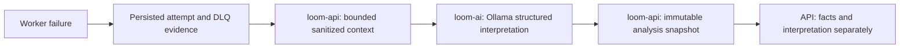
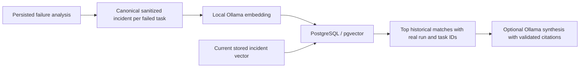
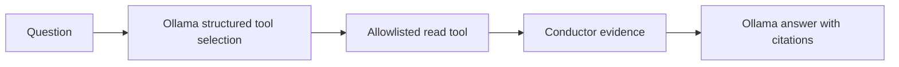
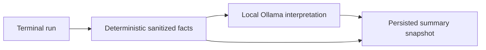
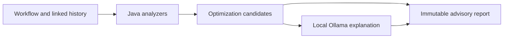
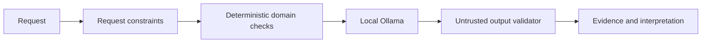
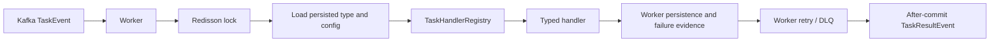

# Conductor

**Conductor evolves [Project Loom](https://github.com/tarunkishore2303/project-loom) into an intelligent distributed workflow platform.** This repository preserves Loom's original Git history. The orchestration modules retain their `loom-*` names while the platform evolves.

The current release includes an isolated Ollama-powered AI service for structured workflow proposals, explicit approval, failure interpretation, and historical incident retrieval. Deterministic validation and execution remain in Conductor. Workers execute typed NOOP, DELAY, HTTP_REQUEST and TRANSFORM capabilities through an IoC handler registry.

See [runtime upgrade decisions and verification](docs/runtime-upgrade.md) for the
Spring Boot 4, Java 25, and Podman migration details.

Distributed async job orchestration engine — a portfolio workflow engine built with Spring Boot, Kafka, Redis, and PostgreSQL.

Submit a DAG of tasks via REST. Loom validates the graph, persists it, and executes tasks across horizontally-scaled workers with distributed locking, exponential backoff retry, dead-letter queuing, and real-time observability.

---

## AI Workflow Generation

Natural language becomes a structured proposal. Conductor validates its DAG,
stores a preview, and creates a normal workflow only after explicit approval.
**The LLM never controls scheduling or task execution.**

```mermaid
flowchart LR
    User[User prompt] --> AI[loom-ai / Ollama]
    AI --> Proposal[Structured proposal]
    Proposal --> Validator[loom-api / existing DAGValidator]
    Validator --> Preview[Stored preview]
    Preview --> Approval[Explicit user approval]
    Approval --> Revalidate[Revalidate]
    Revalidate --> Workflow[Existing WorkflowService / template]
    Workflow --> Execute[Separate normal execution request]
```



AI uses only local Ollama models, with no cloud API key. The optional `ai` Compose
profile starts `loom-ai` and Ollama; normal orchestration runs without them.
Spring AI 2.0.1 is scoped to `loom-ai` and is [compatible with Boot 4.1](https://docs.spring.io/spring-ai/reference/getting-started.html).
The provider sends a native JSON schema to Ollama and strictly validates output
types and bounds. `loom-ai` has no database credentials or Kafka execution
producer. Its separate process isolates model dependencies and timeouts from
orchestration; the tradeoff is one extra local service.

`loom-api` owns proposal persistence and Flyway migrations. Persisting the preview
ensures approval uses exactly the stored content. Approval locks the proposal,
revalidates it, and calls the existing `WorkflowService` in one transaction.
Proposals expire after 24 hours; duplicate approval returns 409. Approval never
starts execution. Original user prompts are not stored with proposals.

### Ollama setup

AI is disabled by default. The optional profile starts a local Ollama container
with a persistent model volume and no published model port. Enable AI and install
the model explicitly; starting Compose does not download model weights:

```powershell
$env:AI_ENABLED = 'true'
$env:AI_MODEL = 'qwen2.5-coder:7b'
.\scripts\compose.ps1 --profile ai up --build -d
.\scripts\compose.ps1 --profile ai exec ollama ollama pull qwen2.5-coder:7b
.\scripts\compose.ps1 --profile ai exec ollama ollama list
```

See [.env.example](.env.example) for Compose settings. `OLLAMA_BASE_URL` defaults
to `http://ollama:11434` in Compose and `http://localhost:11434` for a directly
launched Java service. Windows host Ollama normally listens only on loopback;
Podman may be unable to reach it through `host.containers.internal`, so the
container profile is the default. `AI_REQUEST_TIMEOUT` defaults to 120 seconds;
`AI_SERVICE_TIMEOUT` defaults to 130 seconds for the API. Temperature and output
token limits are configurable with `AI_TEMPERATURE` and `AI_MAX_TOKENS`.

### Preview, approval, and execution

```powershell
$body = @{ prompt = 'Create a workflow that downloads customer orders, validates them, generates invoices in parallel, uploads them and sends a notification.' } | ConvertTo-Json
$proposal = Invoke-RestMethod -Method Post -Uri 'http://localhost:8080/api/v1/ai/workflows/generate' -ContentType 'application/json' -Body $body -TimeoutSec 150
$proposal | ConvertTo-Json -Depth 20
```

Inspect the tasks and validation result. Retrieve the same preview with
`GET /api/v1/ai/workflows/proposals/{proposalId}`. Invalid graphs remain visible
with `validation.valid = false` and deterministic errors; they cannot be approved.
After reviewing a valid preview:

```powershell
$workflow = Invoke-RestMethod -Method Post -Uri "http://localhost:8080/api/v1/ai/workflows/proposals/$($proposal.proposalId)/approve"
Invoke-RestMethod -Uri "http://localhost:8080/api/v1/workflows/$($workflow.id)"
# Execution is a separate normal API request.
$job = Invoke-RestMethod -Method Post -Uri "http://localhost:8080/api/v1/workflows/$($workflow.id)/jobs" -ContentType 'application/json' -Body '{"name":"ai-workflow-demo"}'
Invoke-RestMethod -Uri "http://localhost:8080/api/v1/jobs/$($job.id)"
```

Invalid user requests return 400, malformed model output returns 422, and provider
unavailability/timeouts return 503. Normal workflow APIs continue operating during
AI outages. Model calls have bounded context/output and no automatic retries;
logs omit full prompts and raw provider errors.

The optional smoke script previews by default and can reuse an inspected proposal
without another model call:

```powershell
.\scripts\ai-workflow-smoke.ps1
.\scripts\ai-workflow-smoke.ps1 -ProposalId '<id from preview>' -Approve -Execute
```

Generated workflows use only the supported capability catalog. A business task
name does not create an integration: HTTP needs an explicit URL and transform
input is static. Parallelism is a fixed DAG, without schedules or dynamic fan-out. Human review remains
necessary: a valid graph does not guarantee the requested business semantics.
Authentication/tenant isolation and expired-proposal cleanup are deferred.
Workflow optimization is advisory and read-only. Frontend AI and automatic optimization application are not implemented.

Verified on 2026-10-04: 54 unit tests and 18 Podman integration tests passed. The
real `qwen2.5-coder:7b` model generated the six-task orders DAG with two invoice
branches and a join; all tasks completed after explicit approval and execution.
No workflow template existed before approval. Duplicate approval returned 409;
with Ollama stopped, generation returned 503 while a manual workflow completed.
The successful CPU-only model call took about 78 seconds; local latency varies.

## AI Failure Analysis

Failure analysis keeps execution facts separate from model interpretation. All AI
runs locally through Ollama; no cloud APIs or API keys are used.



`POST /api/v1/ai/runs/{jobId}/analyze-failure` analyzes a failed, settled run.
`GET /api/v1/ai/runs/{jobId}/failure-analysis` retrieves the stored analysis without
calling Ollama. Repeating POST for an unchanged context reuses the persisted result.
Facts include recorded attempts, errors, timestamps, planned retry times, and DLQ
status. `interpretation` contains a likely cause, confidence, explanation, and
recommended actions. Confidence is a model assessment, not a calibrated probability.

`AI_FAILURE_CONTEXT_MAX_CHARS` sets the serialized failure-context JSON character
budget in both the API and AI service (default 32,768; allowed 1–65,536). It is a
character limit, not a model-token limit. Compose passes the same value to both
services; when starting them separately, configure the same value in each.

For interactive requests in VS Code, open [scripts/conductor-demo.http](scripts/conductor-demo.http)
with the REST Client extension (`humao.rest-client`) and click **Send Request**.
The collection includes existing-demo reads and fresh workflow/failure flows with
captured response IDs. Send each section in order and wait for the indicated terminal
run state before analysis; approval and execution remain separate requests.

The API retains database ownership; loom-ai receives bounded facts and has no
orchestration database credentials. V4 adds nullable execution evidence for backwards
compatibility; V5 stores analyses with a unique run/context fingerprint. Legacy
records may lack errors or attempt numbers. Console logs, workflow-template linkage,
external service health, and historical Kafka payloads are not fabricated as facts.
Unavailable evidence is explicit; a run without usable failure evidence is rejected.

For the controlled local demo, explicitly set `DEMO_FAILURES_ENABLED=true` when
starting both workers. Only `demoConnectionTimeout`, `demoDownstreamTimeout`, and
`demoInvalidJson` trigger fixed simulated errors; the default is disabled. Run:

```powershell
python scripts/failure-analysis-smoke.py
```

The smoke script creates a job, checks three failed attempts and terminal DLQ
evidence, requests analysis, and verifies cached reuse. Normal execution remains
separate from analysis. Retry scheduling still uses an in-memory executor; after-commit
Kafka publication avoids reading uncommitted evidence but is not a durable outbox.
Existing DLQ replay limitations are not repaired by AI analysis.

## Incident Memory

Historical retrieval uses actual persisted failures. Facts originate from Conductor;
Ollama supplies advisory interpretation. All chat and embedding inference stays local,
with no cloud APIs or API keys.



The chat model remains `qwen2.5-coder:7b`. Embeddings use
`nomic-embed-text:v1.5` (274 MB), whose **768 dimensions were verified locally**.
It is substantially smaller than the chat model and suitable for short incident
documents on a local development machine. Chat and embedding models are independently
configured. V6 enables pgvector and stores vectors linked to immutable analysis/task
IDs, with a cosine HNSW index and a uniqueness constraint preventing duplicate storage.
Flyway owns schema changes; the AI service has no database credentials or SQL access.
Changing vector dimensions requires a migration and reindexing. Different embedding
model names are never compared; replacing model weights under the same tag requires
deliberate reindexing.

The API uses a small adapter with parameterized pgvector queries instead of a
separate vector-store service or Spring AI's automatic schema setup. This preserves
relational ownership and existing Flyway migrations; the accepted tradeoff is an
explicit 768-dimensional schema and a few application-owned SQL queries. No SQL is
generated by the model. HNSW retrieval is approximate and does not prove that every
related incident has been found.

Explicitly install the embedding model; normal startup never downloads models:

```powershell
.\scripts\compose.ps1 --profile ai exec ollama ollama pull nomic-embed-text:v1.5
```

Set `AI_EMBEDDING_MODEL=nomic-embed-text:v1.5` and
`AI_INCIDENT_MIN_SIMILARITY=0.93` in your local environment. API and AI containers
receive the same embedding-model setting. The 0.93 default was calibrated using the
controlled timeout and invalid-JSON examples, not a general-purpose accuracy benchmark.
Similarity is a cosine score, not a probability. We deliberately filter weak matches;
the threshold may need tuning for real task handlers.

| Endpoint | Behavior |
| --- | --- |
| `GET /api/v1/ai/failure-analyses/{analysisId}` | Exact stored analysis and factual snapshot |
| `POST /api/v1/ai/failure-analyses/{analysisId}/index` | Idempotent explicit indexing/retry |
| `GET /api/v1/ai/runs/{jobId}/similar-incidents?topK=3` | Inspectable historical evidence; no model call |
| `POST /api/v1/ai/runs/{jobId}/similar-incidents/synthesize?topK=3` | Optional evidence-backed interpretation |

With `AI_ENABLED=true`, analysis persistence queues indexing on a bounded background executor. Embedding
outages never invalidate the saved analysis or block execution. Failed/dropped indexing
can be retried explicitly. Indexing supports up to five failed tasks per analysis;
documents are capped at 4,000 characters and exclude raw logs, secrets, and model-authored
execution claims. Search requires a fully indexed current analysis, excludes its entire
run, limits top-K to five, and returns references to real stored incidents. With no
matches, the response is deterministic and does not call the chat model. Previously
indexed incidents remain searchable during an Ollama outage.

Validated synthesis responses use a bounded, process-local 100-entry cache keyed by
the model settings and retrieved evidence. Restarting the API clears that cache;
failure analyses and embeddings remain persisted in PostgreSQL.

Run the controlled three-incident demo after enabling `DEMO_FAILURES_ENABLED=true`
for both workers and explicitly pulling both Ollama models:

```powershell
python scripts/incident-memory-smoke.py --synthesize
```

The script verifies analysis reuse, duplicate indexing prevention, a related timeout
match, exclusion of the unrelated JSON failure, and citations to actual incidents.

The existing PostgreSQL 15 volume is retained when switching to the pinned pgvector
image. Back up an existing database before the image change. If PostgreSQL reports an
OS collation mismatch, rebuild affected indexes before refreshing its recorded version;
see [PostgreSQL's guidance](https://www.postgresql.org/docs/15/sql-altercollation.html).
Fresh volumes need no such repair.

## Ask Conductor

Conductor Copilot is a local, read-only operations assistant. It uses `qwen2.5-coder:7b` through Ollama and returns an answer separately from inspectable evidence and code-owned run/task/analysis/incident references. `answerSource` explicitly distinguishes `OLLAMA_INTERPRETATION` from `DETERMINISTIC_NOTICE`. Model prose is interpretation: inspect code-derived facts and any prior analysis confidence in the evidence rather than treating a likely cause as proven.



`POST /api/v1/ai/copilot/query` accepts `question` and exactly one of `jobId`, `workflowId`, or `analysisId`. Example: `{"question":"How many retries happened?","jobId":"<run UUID>"}`. Other questions include “Why did this run fail?”, “Which tasks failed?”, and “Have we seen this before?”. Run scope offers `getRun`, `getTasks`, `getFailedTasks`, `getTaskAttempts`, `getFailureAnalysis`, and `getSimilarIncidents`; workflow scope offers `getWorkflow`. Stored analyses and indexed incidents are read only: the copilot never generates failure analysis or indexes an incident implicitly.

There are no mutation tools, scheduler access, arbitrary SQL, Kafka publishing, shell execution, or worker calls. Task IDs must belong to the scoped run; historical matches carry explicit references to previous runs. Limits are four tool calls, five model steps, 50 tasks, 300 recorded attempts, five incident matches, 4 KB per tool result, 24 KB total context, and a configurable `AI_COPILOT_TIMEOUT` (default 180 seconds; maximum five minutes). Missing or oversized evidence is reported rather than fabricated. Recorded retry counts and task durations include completeness indicators; task-duration shares are fractions of recorded active attempt time, not workflow wall time.

Run `python scripts/copilot-smoke.py --job-id <analyzed-and-indexed-failed-run>` for the optional live check. The VS Code collection in `scripts/conductor-demo.http` includes query examples. Cold CPU model loading may exceed the provider timeout; such requests return 503 safely.

## Execution Summaries

Terminal `COMPLETE` and settled `FAILED` runs can be summarized on explicit request. Java calculates task-state counts, recorded attempts/retries, observed attempt span, and the five largest contributors to aggregate recorded active task time. Ollama supplies a separate `interpretation` containing an overview, notable events, and observational notes; it never authors the numeric `facts`.



| Endpoint | Behavior |
| --- | --- |
| `POST /api/v1/ai/runs/{jobId}/summary` | Generate if the same evidence has no stored summary; otherwise reuse it |
| `GET /api/v1/ai/runs/{jobId}/summary` | Read the latest stored snapshot, without contacting Ollama |

V7 adds `ai_run_summaries`, unique by run ID and versioned context hash. The hash includes the sanitized execution-evidence fingerprint and optional stored failure-analysis reference. Scheduler updates to `updatedAt` do not cause new model calls. Changed execution evidence can produce a new immutable snapshot. Concurrent requests coalesce within the API process, and the database uniqueness constraint prevents duplicate rows across processes. There is no automatic background generation or failure-analysis regeneration.

`observedAttemptSpanMillis` spans recorded attempt start/end timestamps; it is not an exact engine run duration. Active-duration shares include valid recorded retry attempts and do not represent a critical path or wall-time percentage. Missing or legacy history is explicitly marked incomplete. Runs with active tasks or outstanding retries are rejected even if their job status has already become `FAILED`.

```powershell
python scripts/execution-summary-smoke.py --complete-job-id <complete-run> --failed-job-id <analyzed-failed-run> --expected-retries 2
```

The VS Code request collection includes POST/GET examples. Stored summaries, stored failure analyses, and already-indexed vector retrieval remain available when Ollama is stopped; new copilot answers and uncached summaries require the local model. Prometheus exposes `ai_copilot_*`, `ai_tool_*`, and `ai_summary_*` metrics without entity-ID tags, alongside existing HTTP request metrics in Grafana.

For slower CPU-only machines, the measured cold model load can exceed the default provider deadline. These optional bounded overrides were used for local verification; no model is downloaded by this command:

```powershell
$env:AI_ENABLED='true'
$env:AI_REQUEST_TIMEOUT='180s'
$env:AI_SERVICE_TIMEOUT='190s'
$env:AI_COPILOT_TIMEOUT='240s'
.\scripts\compose.ps1 --profile ai up -d
```

## Workflow Optimization Intelligence

Workflow structure and bounded linked execution history feed deterministic Java analyzers. Java generates candidate IDs and all numeric evidence. Local Ollama (`qwen2.5-coder:7b`) adds a separately validated interpretation.



**Optimization recommendations are advisory. Conductor does not automatically rewrite or execute workflows based on AI recommendations.** There is no apply endpoint, execution access or generalized dataflow. Spring discovers analyzers through IoC; duplicate types fail startup, and the immutable registry assigns snapshot-local candidate IDs.

| Candidate | Evidence threshold |
| --- | --- |
| `SLOW_TASK` | More than 50% of aggregate eligible recorded active attempt duration; at least two task definitions each meet the minimum eligible sample count |
| `HIGH_RETRY_RATE` | At least two executions retried, comprising at least 30% of eligible executions |
| `FAILURE_HOTSPOT` | At least two executions contain failed attempts, comprising at least 30% of eligible executions; recovery and terminal failure counts remain separate |
| `DLQ_HOTSPOT` | At least two executions end dead-lettered, comprising at least 30% of eligible executions |
| `DURATION_IMBALANCE` | Siblings with identical nonempty prerequisites have at least a 3:1 aggregate active-duration ratio across paired eligible executions; zero denominators are excluded |
| `PARALLELISM_CANDIDATE` | Siblings share prerequisites without dependency reachability between them; explicitly a `STRUCTURAL_CANDIDATE` |

Retry frequency is `executions with recorded retries / eligible executions * 100`; failure frequency counts executions containing a failed attempt, and DLQ frequency counts terminal dead-lettered executions. Rate calculations require unique contiguous terminal attempt numbers starting at zero. Timing additionally requires valid start/end timestamps on every attempt. Excluded execution counts remain inspectable. Uncomputed metrics are null rather than zero; sorted run IDs retain the snapshot provenance. Recorded retries count numbered attempts greater than zero, not configured retry limits.

Recorded active duration sums attempt end minus start, including retries and worker dispatch bookkeeping. It includes HTTP waiting and intentional DELAY steps; it is not CPU time. Average active attempt duration divides that sum by attempt count. Duration share uses aggregate eligible task duration, not workflow wall time or critical-path contribution. Sibling comparisons pair the same runs. Structural siblings are already eligible for concurrent DAG scheduling; graph structure does not establish business independence, safe dependency removal or a proven speedup. Every structural candidate retains that limitation.

V9 adds nullable `jobs.workflow_template_id` and persisted `tasks.logical_id`. Future jobs explicitly launched from a template retain both identities before publication. Historical jobs remain unlinked; names/configuration are never used to guess identity. Direct manual jobs remain compatible and unlinked. Optimization accepts bounded safe logical identifiers; workflows with other identifiers remain executable.

Context collection performs bounded bulk reads in a repeatable-read transaction. It selects linked `COMPLETE` or settled `FAILED` jobs in the history window, excludes drifted definitions and unsettled runs, and rejects attempt overflow. Failed runs may contain blocked pending tasks without attempts; running work and scheduled retries are excluded. Missing/legacy attempt numbers and invalid timestamps exclude affected executions from the relevant arithmetic. Truncation and exclusions are explicit. Model context omits URLs, bodies, task configuration and raw error messages.

| API property | Default | Bound |
| --- | --- | --- |
| `conductor.optimization.max-runs` | `50` | `1..50` |
| `conductor.optimization.min-sample-size` | `5` | `2..max-runs` |
| `conductor.optimization.max-candidates` | `20` | `1..20` |
| `conductor.optimization.history-window` | `30d` | positive, at most `365d` |
| `conductor.optimization.max-attempts` | `1000` | `1..1000` |

Compose maps these to `OPTIMIZATION_MAX_RUNS`, `OPTIMIZATION_MIN_SAMPLE_SIZE`,
`OPTIMIZATION_MAX_CANDIDATES`, `OPTIMIZATION_HISTORY_WINDOW` and
`OPTIMIZATION_MAX_ATTEMPTS`; see `.env.example`.

V10 adds `ai_workflow_optimizations`, unique by workflow/context hash. Canonical versioned hashing sorts evidence and excludes update timestamps and request-time noise. Same-context requests reuse immutable reports; changed evidence can produce another snapshot. Requests coalesce within one API process. Database uniqueness prevents duplicate rows across instances, although two instances may both invoke Ollama before one wins persistence. Model latency holds no database transaction or execution lock.

Insufficient-history and no-candidate results are persisted with model `deterministic` without invoking Ollama. Model interpretation must cite existing candidate IDs and pass bounded text/identifier validation before persistence. It cannot change facts. GET only reads storage, and same-context POST reuse works when Ollama is unavailable.

| Endpoint | Behavior |
| --- | --- |
| `POST /api/v1/ai/workflows/{workflowId}/optimization` | Collect, analyze, generate or reuse an advisory report |
| `GET /api/v1/ai/workflows/{workflowId}/optimization` | Retrieve the latest stored report without a model call |

Use the optimization section in `scripts/conductor-demo.http`: a fresh template demonstrates insufficient history; multiple settled template executions provide evidence. Prometheus exports `ai_optimization_requests_total`, `ai_optimization_failures_total` and `ai_optimization_duration_seconds`. The existing Conductor Requests Grafana dashboard includes request, failure and p95 duration panels without entity-ID or task-name tags.

The optional demo fixture can change notification behavior without changing a workflow:

```powershell
$env:TASK_DEMO_NOTIFICATION_STATUS='500' # /orders stays healthy; /notify returns HTTP 500
.\scripts\compose.ps1 --profile demo up -d --no-deps --force-recreate task-demo
# Run the same template several times and wait for settled retry/DLQ evidence.
$env:TASK_DEMO_NOTIFICATION_STATUS='200'
.\scripts\compose.ps1 --profile demo up -d --no-deps --force-recreate task-demo
# Run that same template again to collect successful executions.
```

The live six-run snapshot contained three successful and three DLQ runs. Notification
retry/failure/DLQ rates were 50%, with six recorded retries and nine failed attempts.
The intentional delay contributed 7,206 ms (95.08%) of eligible recorded active attempt
time; the paired sibling ratio was 110.86:1. These are observations from that snapshot,
not workflow latency or performance promises. Repeated POST/GET reused the report.
With Ollama stopped, cached reports, existing analysis/search/summary reads and manual
real workflows remained available; changed-history interpretation returned 503.
Insufficient-history and no-candidate paths also completed without Ollama.

Interpretation policy is versioned separately from the canonical evidence fingerprint.
Known contradictory advice, such as enabling existing parallel scheduling or implementing
existing retry behavior, and selected unsupported speedup promises fail validation with
422 and create no new snapshot. These conservative text checks are not semantic proof:
they can reject legitimate phrasing and cannot detect every inaccurate recommendation.
Human review remains required; the deterministic candidate evidence is authoritative.

## Platform conventions

Exceptions belong to the module that owns the failure: `loom-api.exception` maps public errors to Spring `ProblemDetail`, while `com.loom.ai.exception` preserves the internal AI service's `{code, message}` contract. Invalid input is 400, missing data 404, conflicting state 409, invalid model output 422, and unavailable AI 503. Malformed requests do not echo payloads or parser diagnostics.

Validation has three boundaries:

- Jakarta Bean Validation checks request shape and bounds. Copilot's `@ExactlyOneScope` requires one run, workflow or analysis scope.
- Explicit domain services enforce DAG rules, task ownership and terminal/settled execution state.
- Dedicated output validators check untrusted model interpretations, including evidence citations, identifier grounding and size limits. They cannot replace domain validation.



`loom-observability` provides an explicit `OperationMetrics` scope shared by API and AI services. It records requests, failures, duration and structured correlation logs; services still own exception propagation and business logic. Operations and outcomes are enums, so arbitrary prompts, IDs and URLs cannot become metric tags. Model identity is bounded log metadata only. Existing Prometheus metric families and the **Conductor Requests** Grafana dashboard remain compatible. This wrapper uses direct Micrometer instrumentation rather than AOP, so it works on ordinary calls without proxy restrictions. The module has no persistence dependencies, keeping JPA out of `loom-ai`.

Typed configuration records group AI transport, failure-context limits, copilot deadlines and incident settings. Configuration is constructor-injected and validated during binding; existing environment variables and defaults are preserved. Provider timeout (120 seconds), API transport timeout (130 seconds) and copilot deadline (180 seconds) are distinct budgets. `AI_FAILURE_CONTEXT_MAX_CHARS` supplies the same default 32,768-character limit to API and AI. Invalid deadlines, context limits or similarity thresholds prevent startup rather than failing on a later request.

Task capabilities extend these conventions with typed configuration, dedicated validators and bounded handler instrumentation.

## Task capabilities



| Type | Purpose | Important limits |
|---|---|---|
| NOOP | Orchestration and compatibility | Existing 50 ms simulation; no external work |
| DELAY | Wait step | `durationMillis` 0–30,000; configurable lower ceiling |
| HTTP_REQUEST | GET or POST | Total deadline ≤10 s, request body 16 KiB and response body 64 KiB by default; no redirects |
| TRANSFORM | Static JSON_SELECT or JSON_RENAME | JSON object input 16 KiB by default; at most 50 simple top-level field names; no expressions |

**Conductor does not execute arbitrary shell, code, JavaScript, Python or SQL.** No runtime plugin downloads are supported.

`loom-task-capabilities` owns immutable typed configurations, validated `TaskProperties`, the application-owned capability catalog and a validator registry. Spring discovers handlers as beans; duplicate handler or validator registrations fail startup. Workers dispatch by `TaskType`, without a handler switch in the executor. Handlers cannot publish Kafka events, mutate task state, schedule retries or enter DLQ. Worker-owned retry semantics remain unchanged: execution failures retry through the existing exponential backoff policy, then become DEAD_LETTERED.

Manual templates, direct jobs and AI proposals all pass capability checks plus DAG validation. `GET /api/v1/task-capabilities` exposes the catalog. Ollama receives that catalog and a strict four-capability JSON schema; model output is checked again deterministically. Preview, explicit approval through WorkflowService and separate execution remain required.

Example task definitions:

```json
[
  {"taskId":"check","name":"Check orders","type":"HTTP_REQUEST","config":{"method":"GET","url":"http://task-demo:8080/orders","timeoutMillis":2000},"dependsOn":[],"maxRetries":2},
  {"taskId":"wait","name":"Wait briefly","type":"DELAY","config":{"durationMillis":100},"dependsOn":["check"],"maxRetries":0},
  {"taskId":"select","name":"Select static fields","type":"TRANSFORM","config":{"operation":"JSON_SELECT","input":"{\"id\":42,\"internal\":\"omitted\"}","fields":["id"]},"dependsOn":["wait"],"maxRetries":0}
]
```

JSON_RENAME uses `{"operation":"JSON_RENAME","input":"{\"customer_id\":42}","renames":{"customer_id":"customerId"}}`. Missing source fields and existing rename targets fail safely; fields are literal top-level names, not paths or scripts. Results are transient and bounded; the worker does not persist HTTP bodies or transform outputs.

**Conductor currently orchestrates execution dependencies; generalized dataflow between arbitrary task outputs is not yet implemented.** The example's transform input is static and does not consume the HTTP response.

### HTTP network boundary

Only HTTP(S), GET and POST are accepted. URLs cannot contain credentials, query strings or fragments; custom headers and authentication are unsupported. Bodies must not contain secrets: secret-management integration is not implemented. No response headers/bodies or underlying network exception details are persisted. Controlled failures include HTTP_STATUS_500, HTTP_TIMEOUT, HTTP_CONNECTION_FAILURE and HTTP_RESPONSE_TOO_LARGE.

Literal addresses are validated before persistence. At connection time, the reusable Apache client checks all resolved addresses and supplies those same addresses to its connection operator; there is no separate unguarded resolution. Default policy rejects loopback/private/ULA/shared address space. Metadata addresses (including mapped IPv4 and AWS IPv6), unspecified, link-local, multicast and selected reserved/translation/tunnel ranges remain blocked even with private opt-in. Redirects, automatic HTTP retries, cookies and decompression are disabled. Header count is limited to 64 and each header/status line to 8 KiB. A total task deadline bounds DNS/connect/read/slow-drip responses; an OS DNS lookup may outlive cancellation, with at most eight outstanding lookups per worker client. These application checks complement network egress controls; they cannot prove that every globally routable destination is trustworthy.

Typed settings include `conductor.tasks.delay.max-duration`, `conductor.tasks.http.max-timeout`, `max-request-bytes`, `max-response-bytes`, `allow-private-addresses`, and `conductor.tasks.transform.max-input-bytes`. Startup validation enforces hard ceilings: delay 30 s, HTTP 10 s, request/input 64 KiB and response 1 MiB. Total serialized task config is capped at 64 KiB. Task deadlines fit within the existing 60 s Redis lease; database stalls and process crashes remain separate reliability concerns.

### Local capability demo

The fixed HTTP fixture is opt-in; it is a demo server, not an executable task capability:

```powershell
$env:AI_ENABLED='true'
$env:TASK_HTTP_ALLOW_PRIVATE_ADDRESSES='true' # Demo only; default false
.\scripts\compose.ps1 --profile ai --profile demo up -d --build
python scripts/task-capabilities-smoke.py
```

The local broker defaults to three partitions so both workers can consume. If an existing `task-queue` was auto-created with one partition, expand it without deleting messages:

```powershell
.\scripts\compose.ps1 exec kafka kafka-topics --bootstrap-server kafka:29092 --alter --topic task-queue --partitions 3
```

Use `scripts/conductor-demo.http` for mixed workflows, HTTP 500 retries/DLQ, analysis, incident retrieval, Copilot and summary requests. Internal task URLs use `http://task-demo:8080`; the fixture is also inspectable at `http://localhost:18080/health`. Private-address opt-in is applied consistently to API, AI and both workers. Models still require explicit local pulls from the Ollama setup section; no cloud API or API key is used. On CPU-only hosts, the documented AI deadline overrides may be needed. Dockerfile Gradle commands prefer IPv4 during build downloads to mitigate observed Podman/WSL build-download timeouts; runtime networking is unchanged.

V8 adds `tasks.task_type` (default NOOP) and bounded `tasks.task_config_json` (default `{}`). V1–V7 are unchanged. Old template JSON and callers omitting type/config remain NOOP; supplied incompatible config is rejected. Kafka TaskEvent stays unchanged because workers load the authoritative configuration from PostgreSQL.

Handler metrics use `task_handler_requests_total`, `task_handler_failures_total` and `task_handler_duration_seconds`, tagged only by bounded handler type/outcome. Existing completion/failure counters remain with `handler_type` replacing arbitrary task-name tags; handler timing replaces the old duplicate worker timer. Panels are included in the existing Conductor Requests dashboard.

Known reliability limits remain: retry timers are in memory, after-commit Kafka publication has a crash gap without an outbox, and HTTP side effects cannot be made exactly-once by a database transaction. A POST may repeat after a crash; downstream APIs must supply their own deduplication semantics. AI semantic correctness still requires human approval. There is no generalized dataflow, secret management or dynamic plugin system.

## Architecture

```
┌──────────────┐   POST /jobs    ┌─────────────────────┐
│    Client    │ ──────────────► │     loom-api         │  :8080
└──────────────┘                 │  DAG validation      │
                                 │  Job persistence      │
                                 │  Flyway migrations    │
                                 └─────────┬─────────────┘
                                           │ job-created (Kafka)
                                           ▼
                                 ┌─────────────────────┐
                                 │   loom-scheduler     │
                                 │  Reactive R2DBC      │
                                 │  Root task detection  │
                                 │  Downstream unblock   │
                                 │  Optimistic locking   │
                                 └─────────┬─────────────┘
                                           │ task-queue (Kafka)
                              ┌────────────┴────────────┐
                              ▼                          ▼
                    ┌──────────────────┐      ┌──────────────────┐
                    │  loom-worker-1   │      │  loom-worker-2   │  :8081 / :8082
                    │  Redisson lock   │      │  Redisson lock   │
                    │  Idempotency     │      │  Idempotency     │
                    │  Retry + DLQ     │      │  Retry + DLQ     │
                    └──────────────────┘      └──────────────────┘
                                           │ task-results (Kafka)
                                           ▼
                                 ┌─────────────────────┐
                                 │    loom-monitor      │  :8083
                                 │  Read-only stats     │
                                 │  DLQ browser         │
                                 └─────────────────────┘
```

### Services

| Service | Role | Port | Stack |
|---|---|---|---|
| `loom-common` | Shared entities, DTOs, Kafka events | — | JPA, Jackson |
| `loom-api` | REST API, DAG validation, job persistence | 8080 | Spring MVC, JPA, Flyway, Kafka producer |
| `loom-scheduler` | DAG execution engine, task scheduling | — | WebFlux, R2DBC, Kafka consumer |
| `loom-worker` | Task execution, retry, DLQ | 8081 / 8082 | Spring MVC, JPA, Redisson, Kafka |
| `loom-monitor` | Read-only stats and DLQ browser | 8083 | Spring MVC, JPA |
| `loom-ai` | Structured proposals, failure interpretation, embeddings and incident synthesis; no execution or DB access | 8085 | Spring AI, Ollama, Spring MVC |

### Infrastructure

| Component | Purpose |
|---|---|
| PostgreSQL 15 + pgvector | Jobs, tasks, executions, workflows, analyses and incident vectors |
| Kafka + ZooKeeper | Event bus — `job-created`, `task-queue`, `task-results` |
| Redis | Distributed locks (Redisson) preventing duplicate task execution |
| Prometheus | Metrics scraping from the API, AI service, monitor and workers |
| Grafana | Metrics dashboards |

---

## Key Design Decisions

- **DAG validation** — cycle detection (DFS) and unknown-dependency checks before any DB write
- **Post-commit Kafka publish** — `TransactionSynchronization.afterCommit()` ensures scheduler only sees persisted jobs
- **Reactive scheduler** — R2DBC + WebFlux for non-blocking DAG traversal under load
- **Distributed locking** — Redisson `tryLock` prevents two workers racing on the same task
- **Idempotent execution** — deterministic `executionId = UUID.nameUUIDFromBytes(taskId + attemptNumber)` guards against duplicate processing on retry
- **Exponential backoff** — retry delay = `2^attemptNumber` seconds, up to `maxRetries`
- **FAIL_FAST policy** — on max retries exhausted, cancels all PENDING tasks and marks job FAILED
- **Optimistic locking** — `version` column on both `jobs` and `tasks` prevents lost updates across concurrent workers

---

## Getting Started

### Prerequisites

- Podman + standalone Docker Compose (no Docker Desktop required)
- Java 25 (for local builds only)

### Windows setup

Run the WSL installation in Administrator PowerShell and restart if requested:

```powershell
wsl --install --no-distribution
winget install --id RedHat.Podman --exact
winget install --id Docker.DockerCompose --exact
```

In a new terminal (machine initialization is needed only once):

```powershell
podman machine init
podman machine start
.\gradlew.bat build
.\scripts\compose.ps1 up --build -d
```

The helper locates Podman and a standalone Docker Compose provider even when the
current terminal's PATH has not refreshed. Stop the stack with
`.\scripts\compose.ps1 down`; named volumes retain database data.

Testcontainers uses Podman's Docker-compatible API, not Docker Desktop. On Windows,
`podman machine start` exposes the default named pipe. Run container tests with
`.\gradlew.bat integrationTest`. On other platforms, configure `DOCKER_HOST` for
Podman's socket as described in the [Testcontainers runtime guide](https://java.testcontainers.org/supported_docker_environment/).
Do not disable Ryuk by default; it cleans up temporary test containers.

### Run on Linux/macOS

```bash
./gradlew build
PODMAN_COMPOSE_PROVIDER=docker-compose podman compose up --build -d
```

Services start in dependency order:
1. PostgreSQL, ZooKeeper, Kafka, Redis
2. loom-api (runs Flyway migrations)
3. loom-scheduler, loom-worker-1, loom-worker-2, loom-monitor
4. Prometheus, Grafana

### URLs

| Service | URL |
|---|---|
| API | http://localhost:8080 |
| Swagger UI | http://localhost:8080/swagger-ui.html |
| Monitor | http://localhost:8083/monitor/stats |
| Prometheus | http://localhost:9090 |
| Grafana | http://localhost:3000 (admin / admin) |

---

## API Reference

### Submit a Job

```bash
POST /api/v1/jobs
```

```json
{
  "name": "etl-pipeline",
  "failurePolicy": "FAIL_FAST",
  "tasks": [
    { "taskId": "a", "name": "Extract",   "dependsOn": [],         "maxRetries": 3 },
    { "taskId": "b", "name": "Transform", "dependsOn": ["a"],      "maxRetries": 3 },
    { "taskId": "c", "name": "Load",      "dependsOn": ["b"],      "maxRetries": 3 }
  ]
}
```

`failurePolicy` values:
- `FAIL_FAST` — first dead-lettered task cancels all pending tasks, job → FAILED
- `CONTINUE` — other tasks keep running; job → FAILED only when all terminal

### Other Endpoints

| Method | Path | Description |
|---|---|---|
| `GET` | `/api/v1/jobs/{jobId}` | Get job + task statuses |
| `DELETE` | `/api/v1/jobs/{jobId}` | Cancel job (→ CANCELLING) |
| `POST` | `/api/v1/workflows` | Create reusable workflow template |
| `GET` | `/api/v1/workflows/{templateId}` | Get workflow template |
| `POST` | `/api/v1/workflows/{templateId}/jobs` | Submit job from template |
| `GET` | `/api/v1/dlq` | List dead-lettered tasks |
| `POST` | `/api/v1/dlq/{taskId}/retry` | Re-queue a dead-lettered task |
| `GET` | `/monitor/stats` | Aggregated job + task counts by status |
| `GET` | `/monitor/dlq` | Paginated dead-letter queue view |

### Job + Task Statuses

```
Job:   CREATED → RUNNING → COMPLETE | FAILED | CANCELLED
Task:  PENDING → RUNNING → COMPLETE | FAILED → DEAD_LETTERED | CANCELLED
```

### Example — Diamond DAG

```bash
curl -s -X POST http://localhost:8080/api/v1/jobs \
  -H "Content-Type: application/json" \
  -d '{
    "name": "diamond",
    "failurePolicy": "CONTINUE",
    "tasks": [
      { "taskId": "a", "name": "Ingest",    "dependsOn": [],         "maxRetries": 2 },
      { "taskId": "b", "name": "Branch-1",  "dependsOn": ["a"],      "maxRetries": 2 },
      { "taskId": "c", "name": "Branch-2",  "dependsOn": ["a"],      "maxRetries": 2 },
      { "taskId": "d", "name": "Aggregate", "dependsOn": ["b", "c"], "maxRetries": 2 }
    ]
  }' | jq .
```

---

## Observability

The API, AI service, monitor, and workers expose Prometheus metrics at
`/actuator/prometheus`. The scheduler does not currently expose Actuator metrics.

Open the provisioned [Conductor application requests dashboard](http://localhost:3000/d/conductor-requests)
in Grafana (`admin` / `admin` for the local stack). It shows request counts and
rates, routes/methods/status codes, HTTP errors, API/AI p95 latency, and AI
generation counts, failures, and duration. Use the service selector to focus on
`loom-api` or `loom-ai`. Health checks and Prometheus scrapes are excluded from
business request panels. Routes use templates rather than individual workflow IDs.

Prometheus scrapes and the dashboard refresh every 15 seconds; rates need at
least two samples. HTTP timers record completed requests, while the AI request
counter increments when a generation call starts. Latency histograms include
calls up to 180 seconds. No prompts or request bodies are sent to Grafana.
AI latency cards summarize calls since the AI process started, so a single
generation is visible; request rates use a rolling window. Counters reset when
services restart.

To see traffic without invoking a model or modifying workflows:

```powershell
1..20 | ForEach-Object {
    Invoke-RestMethod 'http://localhost:8080/api/v1/jobs/7975a135-15f6-46fb-b928-e2f84afefa40' | Out-Null
}
```

Replace the demo job ID with one from your own workflow execution. The dashboard
is provisioned from repository configuration; no manual import is required.

Key metrics:

| Metric | Description |
|---|---|
| `loom_jobs_submitted_total` | Jobs submitted, tagged by `failurePolicy` |
| `loom_tasks_completed_total` | Tasks completed, tagged by `taskName` |
| `loom_tasks_failed_total` | Tasks failed, tagged by `taskName` |
| `loom_task_execution_duration_seconds` | Task duration histogram, tagged by `taskName` + `outcome` |
| `http_server_requests_seconds_count` | Completed HTTP requests by route, method, and status |
| `http_server_requests_seconds_bucket` | HTTP latency histogram in the API and AI service |
| `ai_requests_total` | Local model requests by operation: generation, failure interpretation, embedding, synthesis |
| `ai_request_failures_total` | Local model failures by operation |
| `ai_request_duration_seconds_bucket` | Local model latency histogram |
| `ai_incident_search_requests_total` | Historical incident searches |
| `ai_incident_search_failures_total` | Historical incident search failures |
| `ai_incident_search_duration_seconds` | Historical incident search latency by outcome |

---

## Development

### Run Tests

```bash
# Unit tests only
./gradlew :loom-api:test --tests "com.tarunkishore.loom_api.service.DAGValidatorTest"
./gradlew :loom-scheduler:test --tests "com.loom.scheduler.service.DAGSchedulerTest"
./gradlew :loom-worker:test --tests "com.loom.worker.service.TaskExecutorServiceTest"

# Integration tests (requires a running Podman machine)
./gradlew integrationTest

# Windows Podman/Testcontainers connection, if no Docker-compatible default pipe exists:
# $env:DOCKER_HOST='npipe:////./pipe/podman-machine-default'
# $env:TESTCONTAINERS_RYUK_DISABLED='true' # rootless Podman; normal test cleanup still runs
```

Current verification on Java 25 / Podman passed:

- `./gradlew build :loom-api:integrationTest :loom-worker:integrationTest --no-daemon`: 490 unit tests, 43 API integration tests and eight worker integration tests; no failures or skips.
- `python -m unittest discover -s scripts/tests -q`: 27 helper tests.
- `git diff --check`: passed.

Normal tests use fake models; integration tests use real PostgreSQL/pgvector, Kafka
and Redis containers without live Ollama calls. Migration coverage upgrades V7 data
to V8 and preserves historical NOOP tasks.

The local two-worker demo verified overlapping parallel branches, all four handlers,
HTTP 500 attempts numbered 0, 1 and 2 followed by DLQ, and a real Ollama-generated
proposal approved and executed through the normal workflow path. Failure analysis,
local incident embeddings/retrieval, evidence-backed Copilot answers and successful/
failed execution summaries were verified against those runs. Copilot tools expose
recorded retry evidence separately from configured retry limits.

With Ollama stopped, mixed-capability and legacy NOOP workflows still completed,
the controlled HTTP failure still retried and entered DLQ, stored analysis and
summaries remained readable, and indexed incident search remained available.
Repeated summary generation reused the stored row; uncached workflow generation
returned 503. Ollama was restarted after verification.

### Extending task capabilities

Capabilities are application-owned. A future addition requires a bounded task type/config, validator, catalog/schema entry and Spring handler bean; it must retain worker-owned persistence/retry/DLQ. Duplicate registrations fail startup. The current contract is:

```java
public interface TaskHandler {
    TaskType type();
    TaskExecutionResult execute(TaskExecutionContext context) throws Exception;
}
```

### Module Structure

```
conductor/
├── loom-common/       # Shared models, DTOs, Kafka events
├── loom-api/          # REST API + Flyway migrations
├── loom-scheduler/    # Reactive DAG execution engine
├── loom-worker/       # Task executor (scale horizontally)
├── loom-monitor/      # Read-only observability service
├── compose.yml
└── prometheus.yml
```

---

## Tech Stack

- **Java 25** / Spring Boot 4.1.1
- **Spring Data JPA** (loom-api, loom-worker, loom-monitor)
- **Spring Data R2DBC + WebFlux** (loom-scheduler)
- **Spring Kafka** — producer + consumer across all services
- **Redisson** — Redis-backed distributed locking
- **Flyway** — versioned DB migrations owned by loom-api
- **Micrometer + Prometheus + Grafana** — metrics pipeline
- **springdoc-openapi** — auto-generated Swagger UI
- **Testcontainers** — integration tests with real Postgres + Kafka

## Sample curls
``` Submit job — linear chain (A→B→C):                                                                                                                                                                                 
  curl -s -X POST http://localhost:8080/api/v1/jobs \                                                                                                                                                                
    -H "Content-Type: application/json" \                                                                                                                                                                            
    -d '{                                                                                                                                                                                                            
      "name": "my-pipeline",
      "failurePolicy": "FAIL_FAST",
      "tasks": [
        {"taskId": "a", "name": "Extract",  "dependsOn": [],    "maxRetries": 3},
        {"taskId": "b", "name": "Transform","dependsOn": ["a"], "maxRetries": 3},
        {"taskId": "c", "name": "Load",     "dependsOn": ["b"], "maxRetries": 3}
      ]
    }' | jq .

  Submit job — diamond DAG (A→B, A→C, B+C→D):
  curl -s -X POST http://localhost:8080/api/v1/jobs \
    -H "Content-Type: application/json" \
    -d '{
      "name": "diamond-job",
      "failurePolicy": "CONTINUE",
      "tasks": [
        {"taskId": "a", "name": "Ingest",    "dependsOn": [],         "maxRetries": 2},
        {"taskId": "b", "name": "Branch-1",  "dependsOn": ["a"],      "maxRetries": 2},
        {"taskId": "c", "name": "Branch-2",  "dependsOn": ["a"],      "maxRetries": 2},
        {"taskId": "d", "name": "Aggregate", "dependsOn": ["b", "c"], "maxRetries": 2}
      ]
    }' | jq .

  Get job status (replace <JOB_ID> with id from submit response):
  curl -s http://localhost:8080/api/v1/jobs/<JOB_ID> | jq .

  Cancel job:
  curl -s -X DELETE http://localhost:8080/api/v1/jobs/<JOB_ID> | jq .

  Create workflow template:
  curl -s -X POST http://localhost:8080/api/v1/workflows \
    -H "Content-Type: application/json" \
    -d '{
      "name": "etl-template",
      "description": "Standard ETL pipeline",
      "defaultFailurePolicy": "FAIL_FAST",
      "tasks": [
        {"taskId": "e", "name": "Extract",  "dependsOn": [],    "maxRetries": 3},
        {"taskId": "t", "name": "Transform","dependsOn": ["e"], "maxRetries": 3},
        {"taskId": "l", "name": "Load",     "dependsOn": ["t"], "maxRetries": 3}
      ]
    }' | jq .

  Submit job from template:
  curl -s -X POST http://localhost:8080/api/v1/workflows/<TEMPLATE_ID>/jobs \
    -H "Content-Type: application/json" \
    -d '{"name": "etl-run-1"}' | jq .

  View DLQ (dead-lettered tasks):
  curl -s "http://localhost:8080/api/v1/dlq?page=0&size=20" | jq .

  Retry DLQ task:
  curl -s -X POST http://localhost:8080/api/v1/dlq/<TASK_ID>/retry | jq .

  Monitor stats (port 8083):
  curl -s http://localhost:8083/monitor/stats | jq .

  Monitor DLQ:
  curl -s "http://localhost:8083/monitor/dlq?page=0&size=20" | jq . ```
